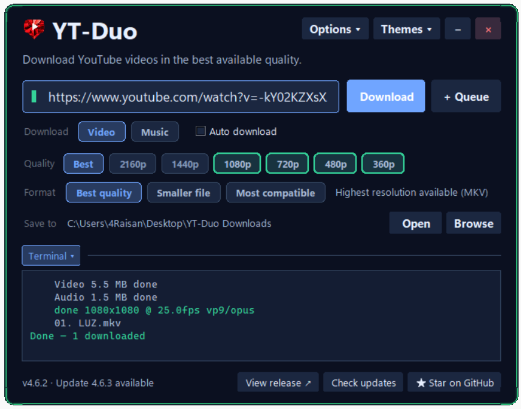

<p align="center">
  
</p>
<p align="center">Download YouTube videos in the best available quality.</p>

A desktop app and command-line tool for downloading **videos or music**, powered by yt-dlp and FFmpeg.

<p align="center">
  
</p>

## Download

**v4.7.0 · [All downloads](https://github.com/4Raisan/YT-Duo/releases/tag/v4.7.0)**

| Platform | Download |
| --- | --- |
| Windows 10/11 x64 | [Portable EXE](https://github.com/4Raisan/YT-Duo/releases/download/v4.7.0/YT-Duo-4.7.0-Portable.exe) · [Setup](https://github.com/4Raisan/YT-Duo/releases/download/v4.7.0/YT-Duo-4.7.0-Setup.exe) |
| Linux | [Launcher](https://github.com/4Raisan/YT-Duo/releases/download/v4.7.0/YT-Duo-4.7.0-Linux.sh) |
| macOS | [Launcher](https://github.com/4Raisan/YT-Duo/releases/download/v4.7.0/YT-Duo-4.7.0-macOS.command) |

**Windows:** Python, Tk, yt-dlp, YouTube JS helpers, FFmpeg, FFprobe, and Deno are included—no separate dependency installation.

**Linux/macOS and source installs:** follow the [dependency setup guide](Releases/README.md#dependencies).

Windows builds are unsigned. Unix downloads are Python launchers, not native app bundles; native macOS GUI execution is unverified. See the [download guide](Releases/README.md) for setup, [source ZIP](https://github.com/4Raisan/YT-Duo/releases/download/v4.7.0/YT-Duo-4.7.0-source.zip), and [checksums](https://github.com/4Raisan/YT-Duo/releases/latest/download/SHA256SUMS.txt).

## Quick start

1. Open YT-Duo and paste a link. Wait for the quality scan.
2. Choose **Video** or **Music**, then your quality. Music supports original audio or MP3.
3. Click **Download**, or enable **Auto download** for verified pastes.

Use **Browse** to change the save folder. Setup defaults to your Windows Downloads folder; portable saves beside the EXE. Music goes into the **Audio** subfolder. Working files and settings stay in a private folder. Single files use the title; queues keep numbered positions.

Also included: queues, pause/resume/stop, duplicate-download prompts, eight themes, adjustable text size, and update checks.

**New in v4.7.0:** enable **Split** and enter From / To times to save part of a video or music track. Only the selected interval plus a short decoding overlap is fetched. See [split downloads](docs/USAGE.md#split-downloads) for supported streams and limits.

The app checks for updates on startup. A green neon **Update to latest** button appears only when a newer version is found; click it to download, verify, and restart. Finish active downloads first. Builds older than 4.6.4 need one manual upgrade. **Star on GitHub** opens the repository.

## Run from source

```sh
python -m pip install -e .
python -m ytduo --gui
```

Verify dependencies with `python -m ytduo --check-dependencies`. For command-line options: `python -m ytduo --help`.

## Learn more

[Usage and settings](docs/USAGE.md) · [Architecture and diagrams](docs/ARCHITECTURE.md) · [Development and builds](docs/DEVELOPMENT.md)

## Architecture


## License

[MIT](LICENSE). See [third-party notices](THIRD_PARTY_NOTICES.md) for bundled components. [Report a problem](https://github.com/4Raisan/YT-Duo/issues).
