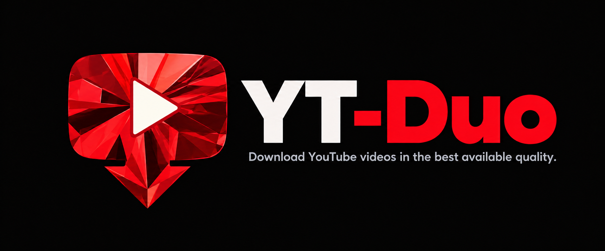
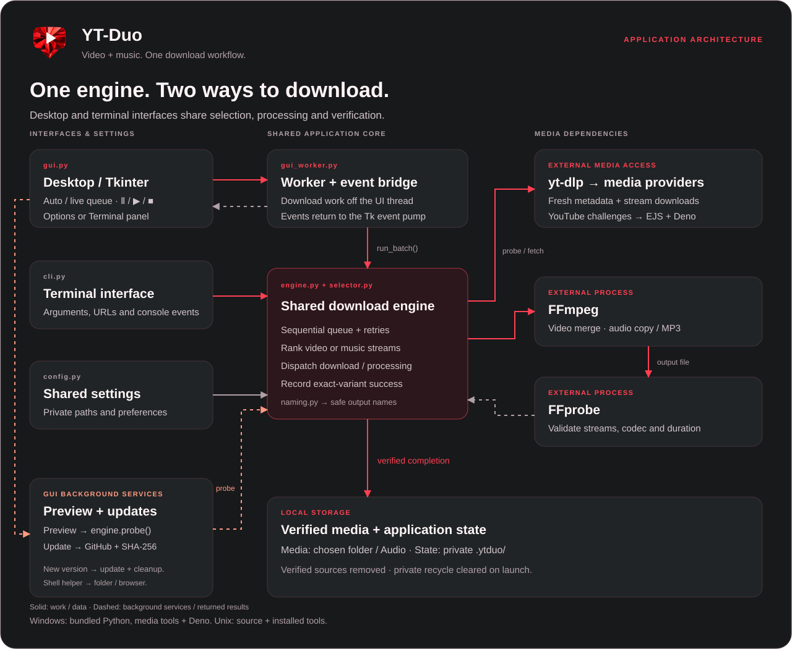

# YT-Duo



Download videos or music with a compact desktop app and command-line interface, powered by yt-dlp and FFmpeg.

## Downloads

Download the Windows portable app, Setup, or Unix launcher from the [latest release](https://github.com/4Raisan/YT-Duo/releases/latest). See the [download guide](Releases/README.md) for requirements and local build locations.

| Platform | File | Requirements |
| --- | --- | --- |
| Windows 10/11 x64 · portable | `windows/YT-Duo-Portable.exe` | No installation; Python and Tk bundled. |
| Windows 10/11 x64 · setup | `windows/YT-Duo-Setup.exe` | Per-user installer, Start menu shortcut, optional desktop shortcut, uninstaller. |
| Linux | `linux/YT-Duo.sh` | Python 3.10+, Tkinter, yt-dlp. |
| macOS | `macos/YT-Duo.command` | Python 3.10+, Tkinter, yt-dlp. |

All versions require FFmpeg and FFprobe on PATH. Deno is recommended for YouTube extraction. Windows executables are unsigned. Unix files embed the source; they are not native app bundles. Native macOS execution has not been verified.

## Use

Paste a link: the app scans available quality in the background. Explicit video tiers glow when offered; **Best** stays automatic. The leading indicator inside the link field is gray while scanning, red for invalid input, and green when verified. The paste hint stays inside the empty field.

- **Video:** Best quality, Smaller file, or Most compatible; choose an automatic or capped resolution.
- **Music:** original audio without re-encoding, or MP3 with Best variable bitrate, 320k, 256k, 192k, or 128k. Conversion cannot improve the source.
- **Auto download:** check the box beside Video/Music to start each verified paste with the selected settings. It starts off each launch; links pasted during a download join the running batch.
- **Options / Terminal:** clear headings and active disclosure buttons. Opening either section closes the other, with no main-window scrollbar. Terminal starts expanded and reopens for every download; logs continue while hidden.
- **Pause / Resume / Stop:** compact Ⅱ / ▶ / ■ controls at the right end of the progress bar. Pause and Stop take effect at engine checkpoints; an active metadata or FFmpeg step may finish first.
- **Already downloaded:** with archive skipping enabled, choose Again or Skip. The compact prompt closes after ten seconds and defaults to Skip; downloading again keeps the existing file.
- Queue several links, add links during a run, or load your own text file. Individual failures do not stop the queue.
- Save to, Browse, and Open appear on the main screen. Options include live text sizes (90–125%), Always on top, and optional automatic folder opening after downloads. Eight themes (Dark, Light, Midnight, Green, Orange, Pink, Yellow, High contrast) and background update checks are available.

Portable Windows defaults to `YT-Duo Downloads` beside the executable. Setup defaults to `YT-Duo Downloads` inside your Windows Downloads folder. Videos go directly into that folder; music goes into its `Audio` subfolder. Browse changes the base folder at any time, and custom choices are saved. Legacy automatic destinations migrate to the new default once; existing media is left in its original location. If the selected destination cannot be created, the app asks for another folder. Portable settings stay beside the executable. Setup installs application files under `%LOCALAPPDATA%/Programs/YT-Duo` and keeps settings under `%LOCALAPPDATA%/YT-Duo/data`. Unix launchers use `~/YT-Duo`. Override the data location with `YTDUO_HOME`. Uninstalling preserves user data. The bundled runtime is cached outside the EXE folder under LocalAppData, falling back to the system temporary folder if necessary. It is required by the portable app; it is not a downloaded-media folder. Known inactive runtime versions are pruned, while active and legacy caches are preserved.

Successful verification deletes the downloaded source streams. The old application recycle folder is cleared on launch and before a batch; completed media is preserved. Interrupted streams may remain in the temporary video/audio folders. Terminal keeps a fixed height, the cursor stays normal, and a rotating indicator inside the link field shows scanning. An empty Download click does nothing.

## Architecture



See the [workflow and module guide](docs/ARCHITECTURE.md).

## Run from source

```sh
python -m pip install -e .
python -m ytduo --gui
python -m ytduo --audio --audio-format original VIDEO_URL
python -m ytduo --audio --audio-format mp3 --audio-bitrate 192 VIDEO_URL
python -m ytduo --help
```

Windows users can also run `YT-Duo.bat`. Put personal links in a text file and select it from the queue; no personal queue or media ships with the project.

## Development

```sh
python -m unittest discover -s tests -t . -q
python scripts/build_release.py
python scripts/build_release.py --windows --setup --iscc "PATH/TO/ISCC.exe"
```

See [development and packaging](docs/DEVELOPMENT.md). Source code, scripts, tests, and documentation are intended for Git; compiled downloads and runtime data are ignored.

Resolution selection does not upscale. A cap can be exceeded if no candidate satisfies it. Cancellation is cooperative; cross-run partial-download resume is not guaranteed. `--no-numbered` is currently accepted but not applied. Updates contact GitHub's public release endpoint and open the release page for manual download; nothing installs automatically.

YT-Duo is independent of YouTube/Google. Download only content you have permission to save.
