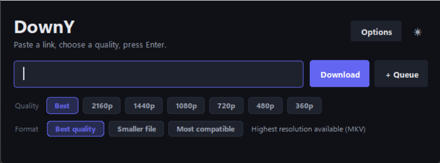
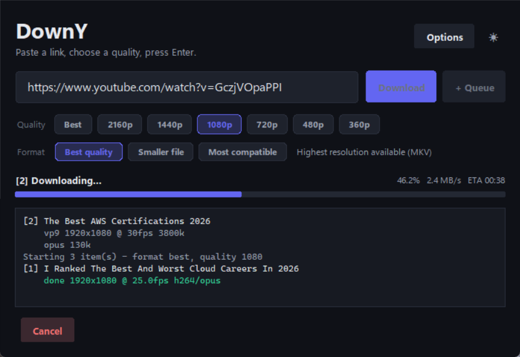
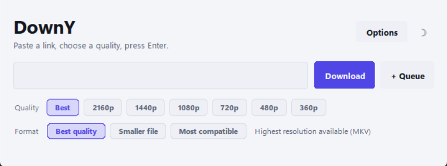

# DownY

A batch video downloader built on [yt-dlp](https://github.com/yt-dlp/yt-dlp).
Drop URLs in a file, run one command, get merged video files out.

Designed for **bulk** work: it keeps going when one item fails, tells you
which ones failed and why, and never silently overwrites a file.

---

## Quick start

Two launchers, both safe to double-click:

| File | Opens |
|---|---|
| **`DownY-GUI.bat`** | the desktop window, with no console left behind |
| **`runner.bat`** | setup check, then the window |

```bat
DownY-GUI.bat              :: window
runner.bat                 :: window (after checking dependencies)
runner.bat cli             :: terminal version on links.txt
runner.bat cli --version   :: any CLI flag
```

Both install anything missing (Python, pip, ffmpeg, deno, yt-dlp) before
starting. If setup changes PATH, they ask you to run them once more.

Add `--no-pause` to `runner.bat` for scripted or scheduled runs so it does
not wait for a keypress (e.g. `runner.bat cli --no-pause`).

Or, if your dependencies are already installed:

```bat
python -m downy                     :: read links.txt
python -m downy --gui               :: open the desktop window
python -m downy -m compat           :: H.264/AAC in MP4
python -m downy -r 720              :: cap resolution at 720p
python -m downy --dry-run           :: preview selections, download nothing
python -m downy https://youtu.be/ID :: one URL, no queue file
```

---

## Desktop window

```bat
DownY-GUI.bat
```

A modern dark UI (with a light mode) drawn entirely on Canvas. tkinter's
native ttk widgets delegate to Windows Visual Styles and ignore colour, so
every control here -- buttons, quality chips, progress bar -- is custom-drawn
to get real colour, rounded corners and animated transitions.

| Idle | Downloading |
|---|---|
|  |  |



- **Quality** is a row of chips (Best / 2160p … 360p). It is a ceiling, not a
  demand: asking for 720p on a 480p video downloads 480p rather than failing.
- **Format** is plain language: Best quality / Smaller file / Most compatible.
- **Options** (output folder, cookies, skip-downloaded, queue) open on demand.
- **☀ / ☾** toggles dark and light; the choice is remembered.
- **Cancel** interrupts the current download immediately, keeping the partial
  file so a rerun resumes.
- The progress bar eases to each new value and shows an animated shimmer while
  a stage has no known percentage (probing, merging). The activity log grows
  with its content instead of reserving a tall empty box.

The GUI holds no downloading logic. It collects a `Settings`, runs
`engine.run_batch` on a worker thread, and renders the events that come back;
widgets are only ever touched on the Tk thread.

---

## The queue file — `links.txt`

One URL per line. Everything else is ignored:

- blank lines
- lines starting with `#`
- lines with no URL in them (notes, separators, leaderboards)
- everything after a `---end---` line

Duplicates are dropped. A line like `Some Tool - https://example.com/` still
contributes its URL. **Never put API keys or passwords in this file** — it is
git-ignored, but it is plain text.

---

## Modes

The mode decides how streams are ranked. It is a policy, not a resolution cap:
DownY always takes the best tier the video actually offers.

| Mode | Video | Audio | Container |
|---|---|---|---|
| `best` (default) | highest resolution, then fps, then bitrate | best audio | MKV |
| `efficient` | highest resolution, preferring AV1 over VP9 | best audio | MKV |
| `compat` | H.264 first — plays anywhere | AAC | MP4 |

The container is chosen from the streams that were **actually** muxed, not from
the mode, so you never get an MP4 containing Opus audio.

Set the mode with any of, in precedence order:

1. `--mode` / `-m` on the command line
2. `"mode"` in `config.json`
3. the `DOWNY_MODE` environment variable

---

## Commands

```
python -m downy [URL ...] [options]

-m, --mode MODE              best | efficient | compat
-r, --resolution HEIGHT      cap video height, e.g. 720 or 1080
-f, --links PATH             queue file to read instead of links.txt
-o, --output DIR             output folder (default: downloads/)
    --gui                    open the desktop window
    --no-numbered            don't prefix filenames with a queue number
    --dry-run                show what would be picked, then exit
    --list-formats           print every available stream, then exit
    --cookies-from-browser   e.g. chrome, firefox, edge (bot checks, age gates)
    --no-archive             re-download items already in the archive
    --cleanup                prune recycle/ and remove leftover .part files
-q, --quiet                  errors and summary only
-V, --version
```

Every run also prunes the recycle cache and sweeps orphaned `.part` files
before starting.

---

## What happens to a download

```
probe ──> pick_streams ──> download video ──> download audio ──> merge ──> verify
                                                                     │
                                                  ffmpeg stream copy │
                                                  ffprobe confirms   │
                                                                     ▼
                                                             downloads/
                                          intermediates ──> recycle/
```

- Streams are **copied**, never re-encoded, so quality is untouched.
- Every output is **verified with ffprobe** against the streams that were
  selected — wrong height, fps, or codec is caught immediately rather than
  discovered later.
- On failure the partial output is deleted; the source streams stay in
  `recycle/` so a rerun resumes cheaply.
- Failed items never renumber the successes: item 3 failing leaves `03.`
  missing, not shuffled.

### Output naming

`01. Title.mkv` — zero-padded queue number plus a sanitised title. The
sanitiser strips Windows-reserved characters, control characters, reserved
device names (`CON`, `NUL`, `COM1`…), trailing dots and spaces, and caps length
at 120 characters (Unicode titles are preserved). If a name already exists,
` (2)`, ` (3)`… is appended. **Nothing is ever overwritten.**

### Folders

| Folder | Purpose |
|---|---|
| `downloads/` | finished files |
| `video/`, `audio/` | in-progress streams |
| `recycle/` | intermediates kept for resuming — a **cache**, pruned by age (72 h) and size (4 GB) |

`.downy-archive.txt` records completed videos so re-runs skip them
(`--no-archive` disables this).

---

## Skipped or failed?

| Message | Meaning |
|---|---|
| `host not supported by yt-dlp` | DownY has no extractor for this site. Fails instantly, no network |
| `YouTube bot check - try --cookies-from-browser` | Add `--cookies-from-browser chrome` |
| `rate limited` | Use a larger gap; reduce the queue size |
| `no usable stream for the selected mode` | Try another `--mode` |
| `ffmpeg failed` | See the message tail; often a corrupt or interrupted source |

Exit codes: `0` all succeeded, `1` some failed, `2` ffmpeg/ffprobe missing,
`130` interrupted.

---

## Development

```bat
python -m unittest test_selector test_engine test_gui -v   :: 200 offline tests
python -m unittest test_gui -v                            :: GUI only
python smoke_test.py                                      :: live network test
python capture_fixtures.py                                :: refresh fixtures
```

All three test modules are offline — no network, no ffmpeg, no real folders
touched. `smoke_test.py` is the only one that downloads.

`test_gui.py` drives the real window: it builds `DownyApp` against a Tk root,
runs genuine worker threads, and asserts on the event flow, progress bar,
cancellation and error dialogs. Only the download itself is stubbed.

### Layout

```
downy/
  config.py        Settings: paths, tunables, mode resolution
  selector.py      Pure format ranking (no I/O, no network)
  naming.py        Filesystem-safe names, collision-free paths
  engine.py        The pipeline (UI-agnostic, event callbacks)
  cli.py           Terminal front-end (argparse)
  gui.py           Desktop front-end (tkinter)
  theme.py         Dark/light palettes, typography, easing
  widgets.py       Canvas-drawn buttons, chips, progress bar
  gui_worker.py    Thread/queue bridge keeping Tk single-threaded
ytd.py             Backward-compatible shim -> python -m downy
```

`engine.py` never prints, never prompts, and never reads `sys.argv`. It reports
progress through an `emit(name, payload)` callback:

```python
from downy.config import Settings
from downy import engine

settings = Settings(mode="compat", max_height=1080)
summary = engine.run_batch(urls, settings,
                           emit=lambda name, data: print(name, data),
                           should_stop=lambda: cancel_flag.is_set())
```

`should_stop` is polled between items **and** between download chunks, so a
front-end can interrupt a large transfer promptly.

That seam is why a web front-end needs no knowledge of yt-dlp or ffmpeg.

### Roadmap

- **Web** (`downy.web`) — paste a link in a browser and get the file. The
  engine is already front-end agnostic; this needs a job queue and a streaming
  response, not a rewrite.

---

## Requirements

Python 3.10+, ffmpeg + ffprobe on `PATH` (or next to the project), and
yt-dlp (`pip install -r requirements.txt`). deno is recommended so yt-dlp can
solve YouTube's JS challenges.


