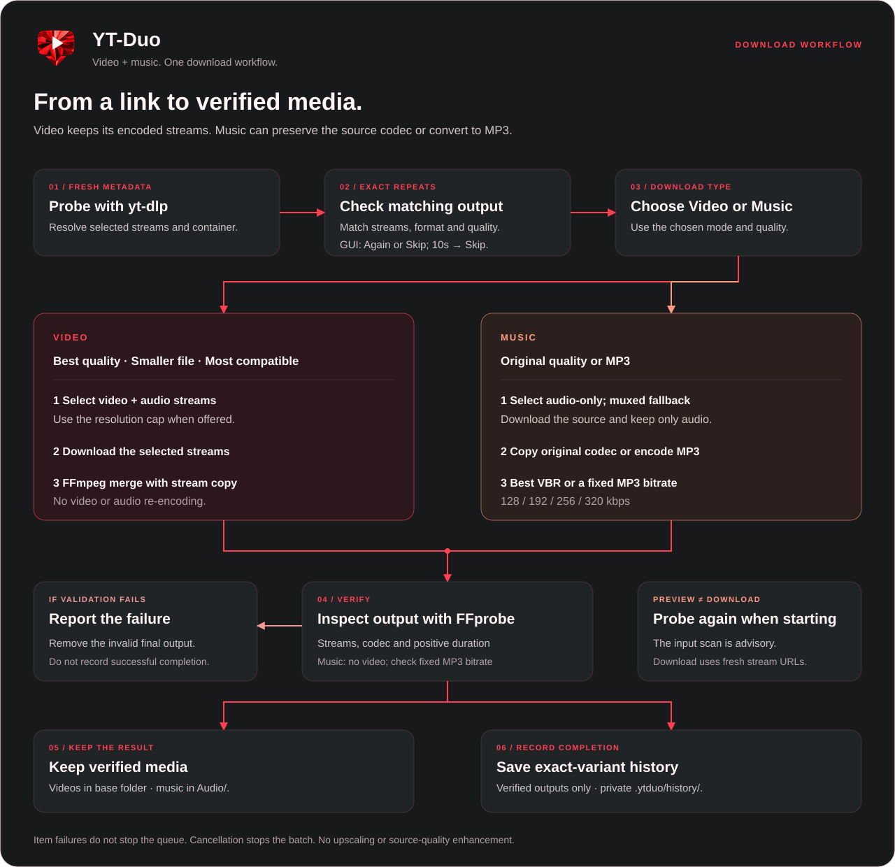

# YT-Duo architecture

YT-Duo is a local Python application with a Tkinter desktop interface and a command-line interface. Both use the same download engine. Media comes from yt-dlp-supported sources; final files, preferences, temporary streams, and completion archives are stored locally. There is no hosted YT-Duo backend or required API key.

Solid arrows show work or data moving through the download workflow. Dashed arrows show background services or returned results, including UI events. FFmpeg produces a file that FFprobe inspects; the engine orchestrates both external processes.

## Video and music workflow

`engine.run_batch()` processes a live, sequential queue. It checks the completion archive before starting an item, accepts additional URLs between items, reports individual failures, and stops the batch when cancellation is observed. Archive skipping can be disabled. Current archive entries track output paths and check that those files still exist; legacy entries without paths use their original URL-only behavior.

Every download probes fresh metadata. `selector.py` ranks streams using the selected policy and resolution cap. A cap is a preference: the engine may select a higher resolution when no candidate satisfies it. It does not upscale media.

- **Video:** fetch the selected video and, when needed, a separate audio stream. FFmpeg merges with stream copy. FFprobe checks video presence, expected audio, resolution, frame rate, codec, and positive duration before completion is recorded.
- **Music:** prefer an audio-only source, with a muxed fallback. FFmpeg keeps only audio. Original quality copies the codec; MP3 uses high-quality variable bitrate for Best or a 128/192/256/320 kbps target. FFprobe checks that the output contains audio, no video, the expected codec, positive duration, and the selected fixed MP3 bitrate when applicable. Conversion cannot improve the source quality.

Verified outputs use safe filenames and collision checks. Successful processing deletes its temporary source streams after verification. Startup and batch cleanup remove only the dedicated, non-linked recycle directory under the application root. Failed validation removes the invalid final output. Completion archives are separate for video, original audio, MP3 Best, and each fixed MP3 bitrate; recording happens after verification and only when archives are enabled.

## Desktop event flow

The Tk thread owns widgets. `gui_worker.Worker` runs the download callable off that thread and emits events through `EventBridge`; the GUI event pump applies the results. Cancellation is cooperative. It is checked between queue items and during stream-download chunks, rather than guaranteeing immediate interruption of every external process.

The input preview has its own background thread and service bridge. Edits use a 300 ms debounce, one active probe, and one latest pending request. Generation IDs reject stale responses. Changing quality or media type reuses the preview metadata; starting a download probes again for fresh stream URLs.

Video is the default. Music hides the video quality/format rows while preserving their selections. The leading indicator inside the input field reports scanning, invalid/unavailable input, or verified media; an overlay hint is shown only while the field is empty. Network failures remain unverified rather than being labelled invalid links.

## Module guide

| Module | Responsibility |
| --- | --- |
| [`gui.py`](../src/ytduo/gui.py) | Desktop controls, preferences, live queue, preview, and service status. |
| [`gui_worker.py`](../src/ytduo/gui_worker.py) | Worker thread, cancellation signal, and event bridge. |
| [`cli.py`](../src/ytduo/cli.py) | Arguments, URL input, console events, and terminal execution. |
| [`config.py`](../src/ytduo/config.py) | Resolved settings, local paths, environment overrides, and archive separation. |
| [`selector.py`](../src/ytduo/selector.py) | Pure stream ranking, music selection, and offered video tiers. |
| [`engine.py`](../src/ytduo/engine.py) | Queue, metadata, fetch/retry, FFmpeg processing, FFprobe validation, and archive/storage helpers. |
| [`naming.py`](../src/ytduo/naming.py) | Filesystem-safe output names and collision suffixes. |
| [`theme.py`](../src/ytduo/theme.py), [`widgets.py`](../src/ytduo/widgets.py) | Eight palettes, Canvas controls, animations, and the outer window border. |
| [`desktop.py`](../src/ytduo/desktop.py) | Windows window shape, native movement, and folder-opening integration. |
| [`updates.py`](../src/ytduo/updates.py) | Stable-version comparison and bounded GitHub release checks. |
| [`_entry.py`](../src/ytduo/_entry.py) | Packaged GUI startup and visible error reporting. |

The Auto download checkbox is session-only and off by default. A successful, current-generation preview triggers the existing single-download path once, reading the selected settings at dispatch. Stale, invalid, failed and incompatible scans cannot start a download. A live batch accepts the link through its existing pending buffer. Preview stream URLs are never reused for downloading.

Options and Terminal are mutually exclusive: opening either closes the other. Terminal starts expanded and reopens when a batch or each item starts, closing Options. Logs continue while hidden. The app uses natural sizing with compact queue rows; there is no main-window scrollbar. Startup constructs the withdrawn root, processes mapping and native-frame layout with zero opacity, and reveals it only after sizing settles. Later mapping uses an idle layout pass independently of update checks.

Pause uses a Condition in EventBridge.checkpoint, called through the engine's existing should_stop callback. Only the worker waits; Resume notifies it and Stop cancels and wakes it. Pause is cooperative at stream hooks and item boundaries, with pending feedback while metadata or processing finishes. Pause / Resume and Stop use symbols at the right edge of the progress track. The Terminal widget keeps six text rows instead of growing with output; the root cursor remains normal. A cancellable 80 ms timer draws the scanning arc within the link field.

The GUI supplies an optional confirm_redownload callback to run_batch. For an archived existing file, the worker emits a request and waits for a thread-safe event. Tk displays a nonmodal, ten-second countdown. Again approves; Skip, timeout, dialog close, Stop and app destruction decline and release the waiter. The engine checks cancellation again before starting the item. CLI callers retain the existing skip behavior without a prompt. Redownloads use the normal safe output-name collision handling.

## Launchers, services, and storage

[`scripts/build_release.py`](../scripts/build_release.py) creates the local Windows executable and Unix launchers. Windows artifacts are staged under build and published by same-volume rename to preserve their normal build integrity. Windows uses the [.NET launcher](../scripts/windows_launcher.cs) and a cached PyInstaller runtime. Unix launchers embed the source and use an existing Python 3.10+ installation with Tkinter and yt-dlp. FFmpeg and FFprobe remain external dependencies; Deno is recommended. See [development and release validation](DEVELOPMENT.md), including desktop launch validation. Folder and GitHub actions share a small [unfrozen shell helper](../scripts/windows_shell.cs), dispatched off the Tk thread; completion/failure returns through the service bridge. Python never changes its live DLL search directory for these packaged actions.

`YTDUO_HOME` overrides the application root. Source runs use the project root; Windows portable uses the launcher folder for settings and temporary streams, Windows Setup uses `%LOCALAPPDATA%/YT-Duo/data`, and Unix launchers use `~/YT-Duo`. The installer keeps program files and user data separate; uninstall preserves user data. Local state includes `config.json`, mode-specific completion archives, the chosen output folder, temporary `video/` and `audio/` streams, and `recycle/`. `YTDUO_MODE` selects a default video policy; `DOWNY_MODE` is a deprecated alias.

At each GUI launch, `updates.py` requests a fresh check of the fixed GitHub latest-release endpoint. Checks run off the Tk thread, use an eight-second timeout, reject redirects, and compare stable numeric tags. A checker also maintains a one-hour in-memory cache for non-forced calls. Update checks do not send download URLs, media, cookies, filenames, or local paths. Repository and release pages open only on user action; updates are downloaded manually.

## Visual assets

- [Brand lockup](assets/yt-duo-logo.png): project name and the established tagline.
- [Square icon](assets/yt-duo-icon.png): faceted red play screen, high-contrast ivory play triangle, and integrated download arrow.
- [Application architecture](assets/architecture.svg) and [download workflow](assets/download-flow.svg): editable, self-contained SVGs with accessible titles and descriptions.

The diagrams describe the implemented code. Branding uses the approved faceted red Playdrop mark, charcoal, warm white, and coral accents. Diagram sources remain editable through `scripts/build_diagrams.py`.

Download destinations are separate from the application data root: portable defaults to launcher-folder/YT-Duo Downloads; Setup resolves the Windows Downloads known folder and appends YT-Duo Downloads. Audio outputs use the Audio child folder of the selected destination. Archives remain in the base destination with per-media filenames. Saved custom destinations win; a destination-layout marker limits legacy-default migration to once. A failed destination creation offers a folder picker.

## Dependency resolution

Windows portable/Setup bundles Python/Tk, yt-dlp and EJS helpers, FFmpeg/FFprobe with their required DLLs, and Deno. Frozen runs prefer the tools inside their own runtime bundle before system PATH; explicit FFmpeg/FFprobe settings still take precedence. Deno is passed to yt-dlp by its absolute bundled path. No dependency installation happens during GUI startup. Source and Unix launchers use installed tools; `--check-dependencies` reports versions and detects missing or broken executables.
